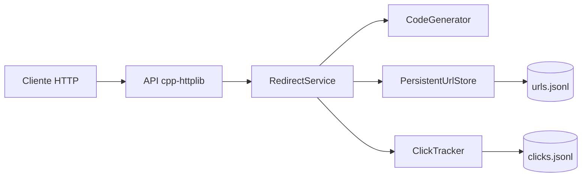

# Encurtador de URL com Analytics

Encurtador HTTP em C++17: cria códigos curtos, redireciona para a URL original e mantém métricas de acesso. A implementação segue a especificação em [`spec.md`](./spec.md).

## Funcionalidades

- `POST /shorten`: recebe `url` e `expires_at` opcional e retorna `201` com `short_code` e `short_url`.
- `GET /{short_code}`: responde `302` com `Location`; códigos inexistentes ou expirados respondem `404`.
- `GET /{short_code}/stats`: informa URL, contagem de cliques e timestamps.
- Códigos base62 de sete caracteres por padrão; inserções concorrentes não sobrescrevem códigos.
- Registros e cliques persistem em arquivos JSON Lines, recarregados na inicialização.

## Compilar e testar

Requisitos: CMake 3.16+, compilador C++17, Git e acesso à Internet na primeira configuração (CMake baixa GoogleTest, cpp-httplib e nlohmann/json via `FetchContent`).

```powershell
cmake -S . -B build -DCMAKE_BUILD_TYPE=Debug
cmake --build build --parallel
ctest --test-dir build --output-on-failure
```

Em Linux/macOS, os mesmos comandos funcionam em um shell POSIX. O teste HTTP usa uma porta local dinâmica.

## Executar

```powershell
.\build\url_shortener.exe
```

Por padrão o servidor escuta em `0.0.0.0:8080` e grava `data/urls.jsonl` e `data/clicks.jsonl`. Configure antes de iniciar:

| Variável | Padrão | Descrição |
|---|---|---|
| `URL_SHORTENER_HOST` | `0.0.0.0` | Interface de rede do servidor |
| `URL_SHORTENER_PORT` | `8080` | Porta TCP (1–65535) |
| `URL_SHORTENER_PUBLIC_BASE_URL` | `http://localhost:8080` | Base incluída em `short_url` |
| `URL_SHORTENER_DATA_DIR` | `data` | Diretório dos arquivos persistentes |

Exemplo de requisições:

```sh
curl -i http://localhost:8080/shorten \
  -H 'Content-Type: application/json' \
  -d '{"url":"https://example.com/a-long-page","expires_at":"2030-12-31T23:59:59Z"}'
curl -i http://localhost:8080/Ab3dE91
curl -i http://localhost:8080/Ab3dE91/stats
```

`expires_at` aceita timestamps ISO 8601 com `Z` ou offset (`+/-HH:MM`) e até três casas decimais. Expira no instante indicado (inclusive). Os stats continuam disponíveis para registros expirados; cliques não são incrementados para redirects inválidos ou expirados.

## Docker Compose

```sh
docker compose up --build
docker compose --profile test run --rm tests
```

O serviço salva os dados no volume `url_data`, que sobrevive à recriação do container. `docker compose down -v` também remove esse volume e os dados.

## Arquitetura



`InMemoryUrlStore` e `ClickTracker` sem caminho de persistência são usados em testes. O armazenamento de arquivos é thread-safe dentro de um processo; compartilhar os mesmos arquivos entre processos simultâneos não é suportado.

## Decisões arquiteturais (ADRs)

### ADR-001: Hash truncado com resolução de colisão

O `CodeGenerator` usa `std::hash` com salt de tentativa, converte para base62 e consulta o `UrlStore` para resolver colisões. A busca é O(1) esperado em relação à quantidade de códigos armazenados, dado o `unordered_map`; calcular o hash ainda depende do tamanho da URL. A biblioteca não garante que `std::hash` gere o mesmo valor entre implementações ou execuções, então não há promessa de códigos estáveis entre versões/toolchains.

### ADR-002: Persistência append-only em JSON Lines

Cada novo registro e clique é acrescentado como uma linha JSON e recarregado no início. Isso mantém o formato simples e permite sobreviver a reinícios sem substituir silenciosamente códigos. Uma linha inválida interrompe a inicialização com erro explícito, em vez de descartar dados. É uma solução local de processo único, não um banco transacional ou armazenamento distribuído.

### ADR-003: HTTP/JSON com dependências header-only via FetchContent

`cpp-httplib` implementa o servidor HTTP e `nlohmann/json` trata os contratos JSON e a persistência. As dependências são fixadas em versões no CMake; não são copiadas para o repositório.

### ADR-004: Semântica de expiração

Um link expira quando `now >= expires_at`. Consultas de analytics ainda retornam os metadados do link expirado, mas o redirect responde `404` e não registra clique.

## Fluxo SDD e uso de IA

Os documentos herdados do repositório registram uso de Claude na elaboração inicial da especificação. Nesta finalização, GitHub Copilot apoiou a implementação e validação técnica. Não foi realizado experimento controlado entre ferramentas, nem revisão por pares: o usuário informou que fará a entrega sozinho. Nenhuma aprovação ou opinião de colega é alegada.

## Pendências que exigem evidência ou ação do autor

- O experimento comparativo de ferramentas de IA exige executar e documentar a comparação real, inclusive a segunda ferramenta; não é inferido a partir deste trabalho.
- O relatório ético deve refletir as decisões e práticas pessoais do autor (privacidade, propriedade intelectual, alucinações e revisão humana); este repositório não comprova essas declarações.
- O PDF de submissão depende do template, critérios e dados de identificação exigidos pelo curso.
- Merge para `develop`/`main`, tag, release e qualquer ação remota ficam para o autor; não foram executados nesta sessão.
